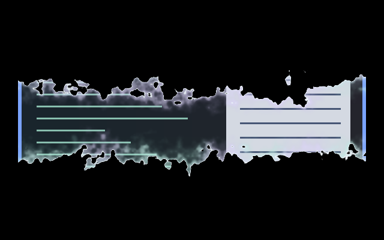

# Animation effects

[Installation and configuration](../README.md#install)

| Preview | Effect | Description |
| --- | --- | --- |
|  | [Petal Scatter](petal-scatter/) | A gust peels flower petals away as the window clears. |
|  | [Petal Gather](petal-gather/) | A curling breeze gathers flower petals along the opening window edge. |
|  | [Vine Plait](vine-plait/) | A horizontal plait of flowering vines rolls up or down across two complete workspace scenes. |
|  | [Fractal Iris](fractal-iris/) | An unfolding fractal front reveals the incoming workspace, with advance tears that widen and merge. |
|  | [Fractal Bloom](fractal-bloom/) | Windows open and close through a mirrored fractal mandala. |
|  | [Cloud Puff](cloud-puff/) | Bright gold, magenta and cyan cloud puffs for window opening and closing. |
|  | [Rangoli Iris](rangoli-iris/) | A full-scene workspace iris with white floral linework, coloured rings and blue spiral beads. |
|  | [ghostly-tear-wave](ghostly-tear-wave/) | Pale ragged fronts open upward and downward from a centre line; closing tears inward from the top and bottom until the line dissolves. |
|  | [witching-hour](witching-hour/) | A ragged orange-and-green fire portal reveals the entire next scene, including wallpaper and shell surfaces. Requires the full-scene workspace reveal API. |
|  | [ghostly-tear](ghostly-tear/) | A pale mint, lavender and pearl portal tears outwards from the centre; scattered holes merge into its ragged opening. Requires full-scene workspace reveal. |
|  | [crescent-reveal](crescent-reveal/) | Pumpkin fire burns the window into existence diagonally from bottom-left to top-right, with a curved flame front and embers. |
|  | [candle-snuff](candle-snuff/) | A quick dim and fade with a small orange-to-green edge flicker, confined to the departing window. |
|  | [Spooky Move](spooky-move/) | After Dark's slow, deeply stretching variation of Wobbly Move for moves, resizes and layout changes. |
|  | [beach-surf-animation](beach-surf-animation/) | A water-and-foam window reveal and disappearance. |
|  | [example](example/) | A minimal opening effect that fades the window in while scaling from 96% to full size. |
|  | [paper-animation](paper-animation/) | A sheet falls and unfurls on opening, then scrunches and falls away on closing. |
|  | [reveal](reveal/) | A bundled opening and closing reveal animation. |
|  | [squash](squash/) | A bundled squash deformation for window movement. |
|  | [tv-glitch](tv-glitch/) | A CRT switching on and off: glitching noise bands, then a collapse to a line and a dot. Ported from Burn-My-Windows. |
|  | [water-conjure](water-conjure/) | A drop lands, a water column rises, and a foamy frame fills inward; closing reverses into a puddle. |
|  | [water-splash](water-splash/) | A water-drop impact seen from above, intended for closing windows. |
|  | [wobbly-lifecycle](wobbly-lifecycle/) | Elastic-sheet deformation for opening and closing windows. |
|  | [wobbly-move](wobbly-move/) | Elastic deformation during animated moves, resizes, and layout changes. |
|  | [shattered-glass](shattered-glass/) | Opening reassembles an irregular fracture map. Closing breaks the window into 41 unequal polygonal shards, with clustered small splinters, large fragments, independent release delays, tumbling, launch velocities, and gravity. |
|  | [wet-paint](wet-paint/) | Opening pours long, uneven paint streams down the window. Closing slowly drains the window in elongated drips, stretching its content through a broad glossy wet region. |
|  | [flame-grilled](flame-grilled/) | Opening sweeps tall, rolling flames downward and leaves the window behind. Closing burns slowly upward, consuming the window under a broad orange and yellow flame body. |
|  | [glitch](glitch/) | Opening vibrates the window into existence through displaced digital bands, staggered blocks, and RGB separation. Closing glitches those blocks out of existence. |
|  | [cells](cells/) | Opening traces glowing pentagonal lines outward from the centre, fills the cells with the window, then withdraws the lines from the perimeter back to the centre. Closing traces the same lines, empties the cells, and retracts the grid inward. |
|  | [void](void/) | Opening grows a broad violet vortex around a black core and releases the twisting window. Closing winds the window into the darkness, with luminous ribbons continuously spiralling inward before the portal seals. |
|  | [old-tv](old-tv/) | Closing collapses the picture into a horizontal phosphor line, then a brighter central blink that lingers before winking out. Opening reverses the slower line-and-afterimage sequence. |
|  | [vhs](vhs/) | Opening introduces the window through horizontal tape stretch, rolling tracking errors, scanlines, noise, and colour bleed. Closing stretches and distorts the picture as it disappears. |
|  | [magic](magic/) | Opening reveals the window from a violet puff surrounded by drifting golden four-point sparkles. Closing dissolves the window into the puff and sparkling dust. |
|  | [triangle-flaps](triangle-flaps/) | Equilateral triangles point alternately up and down. Each independently traces its outline at a random time, then unfolds downward under acceleration to reveal the window. On closing, the triangles hinge downward, fall, and fade at different times. |
|  | [Blood In](blood-in/) | Wave of blood reveals the window top to bottom. |
|  | [Blood Out](blood-out/) | Drains out the bottom with same wave as Blood In. |
|  | [workspace-transation-vhs-ripple](workspace-transation-vhs-ripple/) | Strong VHS tracking distortion and ripples over the native workspace slide. |
|  | [kzzzt-open](kzzzt-open/) | Opening strikes the window into being with one overexposed, torn frame, then it stutters in through displaced bands and phosphor bloom while circuit traces flare at its edges and settle. |
|  | [kzzzt-close](kzzzt-close/) | Closing overdrives the window’s own colours into phosphor and tears it into bands, then blows it out like a fuse, with one overexposed pop and a short fading afterglow. |
|  | [workspace-iris](workspace-iris/) | A clean circular aperture opens from the centre, revealing the incoming scene without moving either image. Requires full-scene workspace reveal. |
|  | [workspace-burn](workspace-burn/) | A noisy advancing burn front consumes the outgoing scene, with a narrow orange hot rim and a broader charred edge. Requires full-scene workspace reveal. |
|  | [workspace-shatter](workspace-shatter/) | Cracks spread through the outgoing scene before irregular rigid shards rotate and fall away, exposing the intact destination. Requires full-scene workspace reveal. |
|  | [workspace-tile-gravity](workspace-tile-gravity/) | Rigid rectangular tiles release at staggered times, mostly from the bottom upward, then tumble and fall away. Requires full-scene workspace reveal. |
|  | [workspace-venetian-blinds](workspace-venetian-blinds/) | Horizontal slats turn in perspective and cascade to edge-on, revealing the destination between them. Requires full-scene workspace reveal. |
|  | [workspace-sand-collapse](workspace-sand-collapse/) | The outgoing scene breaks into tiny rigid grains that lose support in irregular pockets and accelerate downward. Requires full-scene workspace reveal. |
|  | [workspace-crt-scanline](workspace-crt-scanline/) | A narrow scanning beam replaces the outgoing scene with RGB separation, jittered strips, scanlines and electronic noise. Requires full-scene workspace reveal. |
|  | [workspace-melt](workspace-melt/) | The outgoing scene drips along the workspace navigation axis while the destination stays in place. Requires full-scene workspace reveal. |
|  | [workspace-dust-cloud](workspace-dust-cloud/) | Both stationary scenes fracture into tiny drifting chips; overlapping dust clouds disperse and gather into the destination. Requires full-scene workspace reveal. |
|  | [workspace-glitch-phase](workspace-glitch-phase/) | Video tears and misregistered colour channels accompany staggered block replacement across the whole scene. Requires full-scene workspace reveal. |
|  | [workspace-noctalia-wave](workspace-noctalia-wave/) | An irregular diagonal wave turns the scene into dark purple mosaic tiles, then flips the tiles into the destination. Requires full-scene workspace reveal. |
|  | [workspace-transporter](workspace-transporter/) | Continuous blue-white shafts carry vertical streaks of the outgoing scene, with drifting glints, then clear to the destination. Requires full-scene workspace reveal. |
|  | [workspace-wipe](workspace-wipe/) | A straight edge reveals the incoming scene along the workspace navigation axis. Requires full-scene workspace reveal. |
|  | [vampire-blood-wash](vampire-blood-wash/) | Glossy crimson blood washes across the full scene: top-left to bottom-right downwards, bottom-left to top-right upwards. Requires workspace `style = "reveal"`. |
|  | [blood-sweep](blood-sweep/) | Wave of blood sweeps across the screen during a workspace switch. Requires workspace `style = "reveal"`. |
