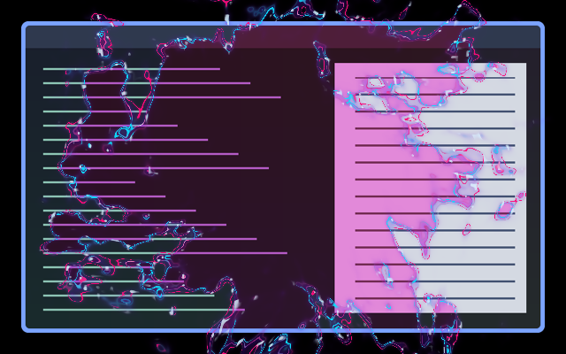

# The Anomaly

An irregular portal tears open from the centre, revealing the next workspace through ragged holes that merge into a larger opening. Cyan and hot-magenta filaments peel away from both sides of the rim, with violet glow and pale sparks.

[Watch the portal grow](preview.gif). These previews render the actual shader in software GLES using two previously captured synthetic desktops; they are not a fresh compositor capture.

## Use and tuning

Include [effect.toml](effect.toml), then select `arcane.anomaly`. Merge [config.toml](config.toml) into existing tables. In the plugin’s local checkout mode, **Refresh** updates the selected preset. Workspace style must be `reveal`; the supplied example uses 1050 ms and a linear curve. Existing plugin timing overrides are retained on refresh.

Both full workspace scenes remain stationary. The incoming scene appears inside the portal; the outgoing scene remains outside it. The centre-out coverage field is adapted from Ghostly Tear, with evolving neon discharge replacing its pale fabric lighting. Forward coverage never closes again; reversing progress retraces both the opening and the electricity.

Controls at the top of [shader.glsl](shader.glsl):

- `RAGGEDNESS = 1.35`: torn lobes, detached holes and islands; useful range 0–2.
- `GLOW_WIDTH = 0.022`: glow width as a fraction of the shorter output dimension.
- `RIP_REACH = 0.055`: reach of the secondary cyan/magenta rips, in the same units.
- `INTENSITY = 0.95`: artwork strength; does not affect scene coverage.
- `CYAN`, `MAGENTA`, `VIOLET`: fixed colours, independent of the theme palette.

Electricity evolves with transition progress, so a held swipe freezes the discharge and a reversed swipe retraces it. No feedback buffers or extra textures; two scene samples and procedural noise per pixel. No artwork requests continuous frames after the transition.

## Validation and limitations

On 2026-11-06, software GLES compilation and linking with the local Umbriel host preamble and animation wrapper passed. 960 frames cover wide and tall logical sizes, scales 1/1.5, two seeds, opaque and transparent inputs, different input alphas, overshoot and repeated progress. Exact outgoing/incoming endpoints, premultiplied alpha, bounded output alpha and reproducible reverse progress pass. A 33-frame two-scene motion sequence was generated and representative frames inspected. Configuration and unpublished catalogue validation pass.

A fresh native compositor test with installed Umbriel `aa3b6b3` was attempted but could not allocate a headless output buffer on the current graphics setup. This revision therefore still needs live workspace/gesture testing. Hardware performance, HDR, output rotation and native fractional scaling remain unverified.

## License

Copyright (c) 2026 Barrulus. [MIT](../../LICENSES/Barrulus-MIT.txt). Arrival-field geometry adapted from [Ghostly Tear](../ghostly-tear/) by Barrulus under the same license. Unofficial work inspired by Arcane.
