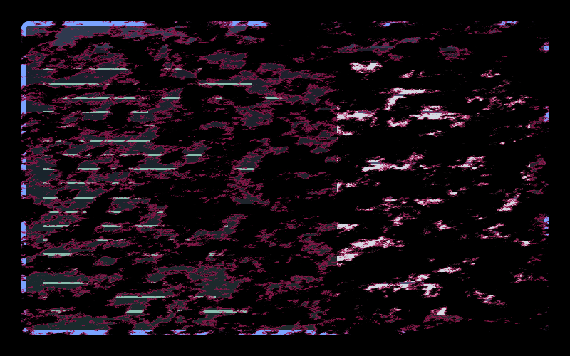

# Paintburst

A closing window breaks into diagonal dry-brush pigment islands with magenta and cyan edges.

An unpublished member of **Arcane Inspired**, for local testing. Original procedural artwork by Barrulus; no extracted show assets.

## Use and tuning

Include [effect.toml](effect.toml), then select `arcane.paintburst`. Merge [config.toml](config.toml) into existing tables. In the plugin’s local checkout mode, refresh **Arcane Inspired** to load this revision. Fixed cyan, magenta and brass constants are at the top of [shader.glsl](shader.glsl); palette adaptation is intentionally disabled.

An anisotropic three-octave pigment field breaks up coverage throughout the window. Progress controls erosion, with explicit visible and hidden endpoints. One texture sample.

## Validation and limitations

Compiled and captured with Umbriel 0.1.0 (`b6c4b7d`) in private native compositor sessions. Native window closing. Preview inspected. Configuration and unpublished catalogue validation pass.

This is a revised local prototype, not a final visual approval. Hardware performance, HDR, output rotation and fractional scaling have not been measured. No feedback buffers or external textures. Costs scale with target size; time-dependent persistent effects request frames.

## License

Copyright (c) 2026 Barrulus. [MIT](../../LICENSES/Barrulus-MIT.txt). Unofficial work inspired by Arcane.
