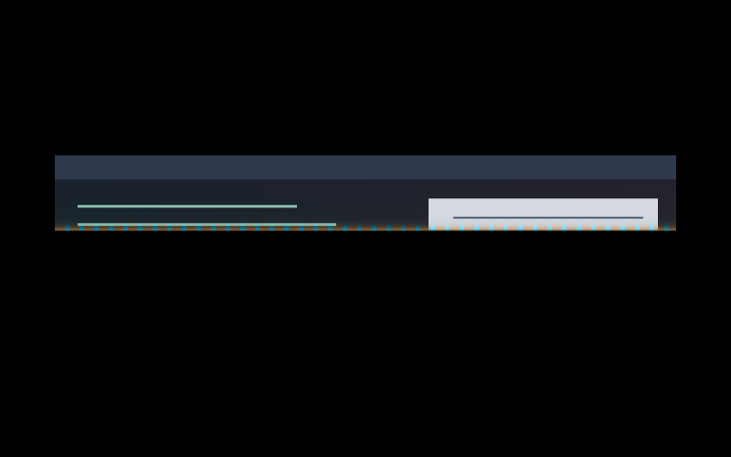

# Piltover Slide

Panels slide behind a crisp brass reveal bar punctuated by cyan teeth.

A member of **Arcane Inspired**. Original procedural artwork by Barrulus; no extracted show assets.

## Use and tuning

Include [effect.toml](effect.toml), then select `arcane.piltover-slide`. Merge [config.toml](config.toml) into existing tables. In the plugin’s local checkout mode, refresh **Arcane Inspired** to load this revision. Fixed cyan, magenta and brass constants are at the top of [shader.glsl](shader.glsl); palette adaptation is intentionally disabled.

Eight-percent vertical displacement resolves into the final surface. The front has 16-pixel cyan teeth. One texture sample.

## Validation and limitations

Compiled and captured with Umbriel 0.1.0 (`b6c4b7d`) in private native compositor sessions. Native layer-shell panel opening, midpoint and finished captures. Preview inspected. Configuration and unpublished catalogue validation pass.

This is a revised local prototype, not a final visual approval. Hardware performance, HDR, output rotation and fractional scaling have not been measured. No feedback buffers or external textures. Costs scale with target size; time-dependent persistent effects request frames.

## License

Copyright (c) 2026 Barrulus. [MIT](../../LICENSES/Barrulus-MIT.txt). Unofficial work inspired by Arcane.
