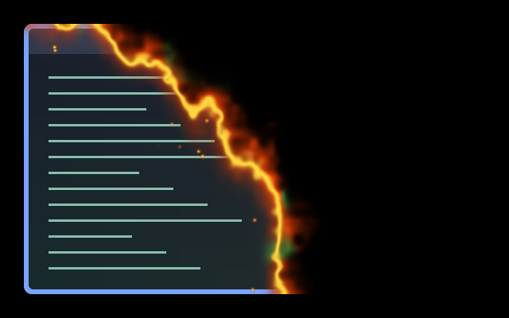

# Crescent Reveal — Pumpkin Fire

Pumpkin fire ignites at the bottom-left and burns the window into existence toward the top-right. A curved, irregular burn front has a yellow-hot core, orange flame tongues, occasional witch-green fire and drifting embers.

Part of [Umbriel After Dark](../../families.toml).

This is an isolated Umbriel capture over synthetic content. A still image does
not demonstrate motion, output transforms or performance.

## Use

Save this directory under `~/.config/umbriel/shaders/community/animation/crescent-reveal/`.
Merge [config.toml](config.toml) into your configuration, appending include paths
and merging existing tables. Including a preset registers it; selection enables
it. Choose **After Dark → Apply family** in the plugin.

## Configuration options

Opening duration = 1300 ms (try 1000–1800). INTENSITY = 1.0 (0–1), FLAME_DEPTH = 48 logical pixels (24–72). Linear event progress drives both reveal and flame motion.

## Compatibility and cost

Requires Umbriel’s preset-effects API. Designed for windows_in. One source sample, noise and 14 bounded ember candidates; no feedback. Exact visible and invisible endpoints, valid premultiplied alpha, and reverse playback supported. Candle Snuff remains the family’s shorter closing animation.
Hardware performance has not been benchmarked.

The supplied preview does not verify HDR, rotated outputs or fractional scaling.

## Attribution

Original shader by Barrulus. [MIT license](../../LICENSES/Barrulus-MIT.txt).

[Animated compositor preview at the configured speed](preview.gif)
