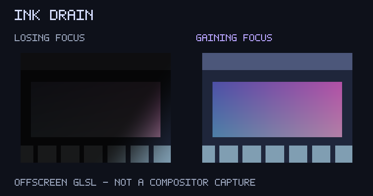

# Ink drain (experimental)

A dark desaturating diagonal sweep affects only the window losing focus.

## Try it

Unpublished experiment (`publish = false`), available through the plugin's local-checkout catalogue mode. Include [effect.toml](effect.toml), then merge [config.toml](config.toml) into existing Umbriel tables and append to your include list. The configuration selects only `animation.dim_unfocused`, enables its master/event switches, and uses a deliberately bold 750 ms linear transition. Choose one preset per slot; including its definition alone does not select it.

Targets latest Umbriel with the `animation.dim_unfocused` custom effect slot and the documented animation GLSL inputs. This is a temporary focus-change accent. Native dim = 0.45 supplies the lasting unfocused darkening; the shader returns its input at both endpoints.

## Tune

Edit `INK_STRENGTH` in [shader.glsl](shader.glsl); suggested range: 0.4–1.0. Adjust `duration_ms` (try 500–900 ms) in your configuration. Linear timing makes the experiment easy to inspect; a duration-based easing curve can be substituted. Trigger a fresh transition after shader reload.

## Cost and validation

1 texture sample per fragment, bounded arithmetic, no feedback buffers, extra textures, audio or pointer inputs. Returns premultiplied RGBA. Bright accents may exceed SDR white. Transparent samples remain transparent.

Validated with Umbriel 0.1.0 (`11c3a82`): activation configuration and combined definitions pass. All ten shaders compile under Mesa llvmpipe GLES; 420 offscreen cases across the batch cover both directions, clamped overshoot, exact endpoints and transparent/partial-alpha input.

Preview: actual GLSL rendered offscreen over synthetic content and visually inspected, not an Umbriel compositor capture. Native slot appearance, interrupted transitions, HDR, rotation, fractional scaling and hardware performance require live testing. This experiment is deliberately exaggerated.

## License

Original shader by Barrulus, Copyright (c) 2026 Barrulus, MIT. Retain [the license notice](../../LICENSES/Barrulus-MIT.txt).

## Focus direction

Only losing focus (`umbriel_direction < 0`) receives the ink sweep. Gaining focus returns unmodified content throughout the transition, allowing native opacity to recover without an ink accent. The preview compares losing focus (left) and gaining focus (right). The directional update passes 42 offscreen GLES cases covering both directions, clamped progress, endpoints and transparent/partial-alpha input. Live compositor behaviour still requires testing.
