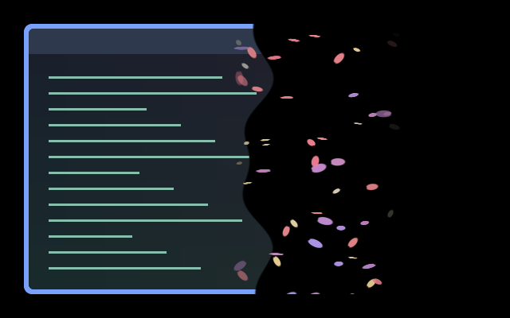

# Petal Scatter

A gust peels cream, pink and lilac petals from the receding right edge of a
window. The content clears from right to left while petals curl and drift
rightward through the cleared region. Paired with
[Petal Gather](../petal-gather/).

Part of [Flowering Vine](../../families.toml). The family intentionally has
no screen or movement default.



[Watch the complete transition](preview.gif).

The preview is a real compositor capture over synthetic sample content.

## Use

Save `effect.toml` and `shader.glsl` together under
`~/.config/umbriel/shaders/community/animation/petal-scatter/`, retaining the licence notices.
Merge [config.toml](config.toml) into your configuration:

```toml
# Merge into existing tables and append to your include list.
[include]
files = ["shaders/community/animation/petal-scatter/effect.toml"]

[animation]
enabled = true

[animation.windows_out]
enabled = true
effect = "flowering-vine.petal-scatter"
duration_ms = 850
curve = "linear"
```

Append to existing include lists and merge existing tables. Including the
preset registers it; the selector enables it. Choose **Flowering Vine →
Apply family** in the plugin to select the coordinated defaults.

## Tuning

Edit named controls in `shader.glsl`; edit event timing in your main
configuration. These are not extra preset TOML keys.

| Control | Default | Effect |
| --- | --- | --- |
| `PETAL_SIZE` | `8.0` logical pixels | Base petal length; individual petals vary in size. |
| `WIND_CURL` | `0.11` | Curl amplitude as a fraction of the shorter window dimension. |
| `PETAL_OPACITY` | `0.94` | Petal opacity, ultimately clamped to 0–1 during composition. |
| Event `duration_ms` | `850` ms | Larger values slow the departing gust. |

The shipped curve is `linear`; easing changes the phase timing, and spring
curves choose their own duration.

The flower colours softly follow the theme palette. Set `palette = false`
in `effect.toml` for the original cream, pink and lilac flowers. Green stems
and leaves keep their botanical colours.

## Compatibility and cost

Uses Umbriel's preset-effects API for `animation.windows_out`. Both the master
animation switch and the event must be enabled. The closing starts with the
unmodified source and finishes fully transparent. Artwork stays inside the
captured window rectangle and respects transparent source pixels.

One source sample and 64 bounded petal candidates per pixel, with early
distance rejection. No feedback buffers. Petals fade before each flight wraps
and at both animation endpoints. The complete output remains premultiplied.

Compiled and captured with Umbriel `0.1.0 (a37ae93)` at scale 1.
HDR, rotated outputs and fractional scaling have not been visually verified.
No performance benchmark is claimed.

## Attribution

Original shader by Barrulus. License: [MIT](../../LICENSES/Barrulus-MIT.txt).
