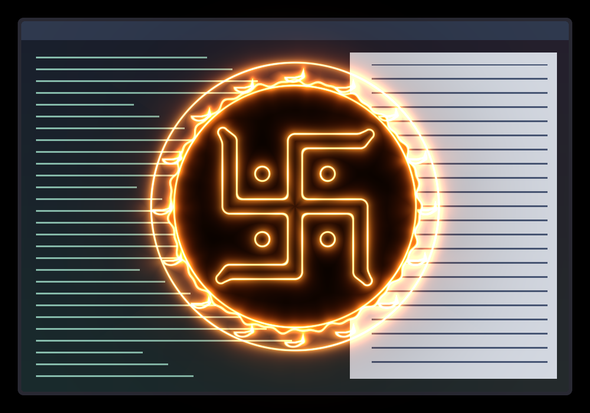

# Shubh Swastik

A Diwali workspace transition for the [Umbriel](https://docs.noctalia.dev/umbriel/) compositor.

An upright, clockwise Hindu swastika (卐) traces out from the centre as a
glowing outline, with rounded arms, full-length hooks, small flicked tips and
four bindu. A double ring of 16 diyas lights up one by one, clockwise from the
top. A portal with a wavering amber edge then opens behind the symbol onto the
next workspace, and the symbol fades. The colours are molten amber and orange
with white-hot line centres. Nothing rotates; the symbol stays upright.

[Animated preview](preview.gif).

## Files

- `shader.glsl`: the effect (GLSL ES 1.00, Umbriel animation kind).
- `effect.toml`: the preset definition, named `shubh-swastik`.
- `config.toml`: an example of how to turn it on.

## Install

1. Copy this folder to `~/.config/umbriel/shaders/community/animation/shubh-swastik/`.
   Keep the [MIT notice](../../LICENSES/Zero-MIT.txt) with your downloaded files.
2. Merge `config.toml` into your `~/.config/umbriel/config.toml`. Add the
   include path to your existing `[include] files` list rather than adding a
   second `[include]` table.
3. Umbriel reloads the config on save. Switch workspaces to see it.

Requirements:

- `[animation.workspaces] style = "reveal"`. This is a full-scene workspace
  reveal: it uses both the outgoing and incoming scenes.
- Requires the full-scene workspace reveal API; the version number alone does
  not distinguish compatible Umbriel builds.

## Tuning

Edit the constants at the top of `shader.glsl`. Umbriel reloads it on save;
switch workspaces again to see the change.

| Constant | Default | Meaning |
| --- | --- | --- |
| `SYMBOL_SIZE` | 0.14 | Stem length, fraction of the shorter screen side. |
| `ARM_WIDTH` | 0.22 | Thickness of the hollow arms, fraction of the stem. |
| `CORNER_ROUND` | 0.10 | Softness of the inner corners. |
| `HOOK_LEN` | 1.0 | Hook length; 1.0 keeps the arms aligned. |
| `TIP_LEN` | 0.17 | Length of the flicked tip at each hook end. |
| `TIP_TAPER` | 0.65 | Tip thickness at its end; 1.0 means no taper. |
| `TIP_ANGLE` | 38 | Degrees the tip turns outward. |
| `LINE`, `GLOW` | 0.022, 0.07 | Line core width and glow falloff. |
| `SHIMMER` | 0.25 | Light flowing along the lines; 0 for steady lines. |
| `DIYAS` | 16 | Number of diyas in the ring. |
| `DIYA_SCALE` | 1.0 | Diya size. |
| `RING_INNER`, `RING_OUTER` | 1.85, 2.20 | Ring radii, in stems. |
| `RIM_WOBBLE` | 5.0 | Waver of the portal edge in pixels; 0 for a round edge. |
| `DRAW_END`, `REVEAL_START`, `FADE_START` | 0.40, 0.30, 0.70 | Timing, as fractions of the transition. |
| `CORE`, `GOLD`, `EMBER` | | The three colours. |

The duration comes from `duration_ms` in your config (1200 recommended), with
`curve = "linear"`.

## Validation and cost

Configuration validation, native GPU compilation and 31 frozen-clock compositor
frames passed with Umbriel 0.1.0 (`33a782d`) on 2026-11-14. The preview shows
progress 0.55 on a 1600 ms linear timeline at 1000×700, scale 1, over synthetic
content with an empty incoming workspace. The supplied README also reports
prior testing on `8e13926`. The animated preview uses 800×560 captures at 40 ms
steps over the configured 1200 ms transition. Both captured endpoints match
their resting scenes pixel for pixel.

This effect samples both workspace scenes and evaluates procedural stroke,
ring, flame and glow calculations per pixel. It has no texture assets or
previous-frame feedback. Additive glow can wash out detail on bright backgrounds.
The captured sequence was visually inspected. Real-time smoothness, GPU
performance, HDR, output rotation and fractional scaling remain unverified.

## Related effects

Part of the Diwali family alongside [Rangoli Iris](../rangoli-iris/),
[Diya Lights](../../border/diya-lights/), and
[Festival Sparks](../../cursor/festival-sparks/). Select Shubh Swastik for
workspace transitions; the family default remains Rangoli Iris.

## License

By Zero (`zero_likes_nothing`). Distributed under the
[MIT license](../../LICENSES/Zero-MIT.txt); retain that notice when redistributing.
