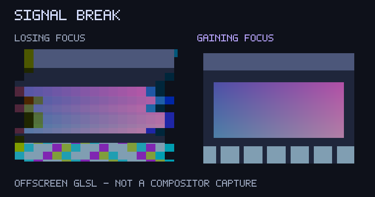

# Signal break (experimental)

The window losing focus fractures into coarse pixels, displaced strips and split colour; the incoming window stays clear.

## Try it

Unpublished experiment (`publish = false`), available through the plugin's local-checkout catalogue mode. Include [effect.toml](effect.toml), then merge [config.toml](config.toml) into existing Umbriel tables and append to your include list. The configuration selects only `animation.dim_unfocused`, enables its master/event switches, and uses a deliberately bold 600 ms linear transition. Choose one preset per slot; including its definition alone does not select it.

Targets latest Umbriel with the `animation.dim_unfocused` custom effect slot and the documented animation GLSL inputs. A stable transition seed varies the broken strips; stepped timing deliberately produces a jerky signal fault.

## Tune

Edit `BREAK_PX` in [shader.glsl](shader.glsl); suggested range: 12–80 logical pixels. Adjust `duration_ms` (try 500–900 ms) in your configuration. Linear timing makes the experiment easy to inspect; a duration-based easing curve can be substituted. Trigger a fresh transition after shader reload.

## Cost and validation

3 texture samples per fragment, bounded arithmetic, no feedback buffers, extra textures, audio or pointer inputs. Returns premultiplied RGBA. Bright accents may exceed SDR white. Transparent samples remain transparent.

Validated with Umbriel 0.1.0 (`11c3a82`): activation configuration and combined definitions pass. All ten shaders compile under Mesa llvmpipe GLES; 420 offscreen cases across the batch cover both directions, clamped overshoot, exact endpoints and transparent/partial-alpha input.

Preview: actual GLSL rendered offscreen over synthetic content and visually inspected, not an Umbriel compositor capture. Native slot appearance, interrupted transitions, HDR, rotation, fractional scaling and hardware performance require live testing. This experiment is deliberately exaggerated.

## License

Original shader by Barrulus, Copyright (c) 2026 Barrulus, MIT. Retain [the license notice](../../LICENSES/Barrulus-MIT.txt).

## Focus direction

Runs only while losing focus (`umbriel_direction < 0`). Gaining focus returns the unmodified target so the incoming window remains readable while its native opacity recovers. Both native focus transitions still run; this shader adds its treatment to only one side. Directional previews show losing focus on the left and gaining focus on the right, at progress 0.5.

The directional update is checked by compiling the GLSL under Mesa llvmpipe GLES and testing both directions, endpoints, clamped overshoot and transparent/partial-alpha targets. This is offscreen validation, not live compositor testing.
