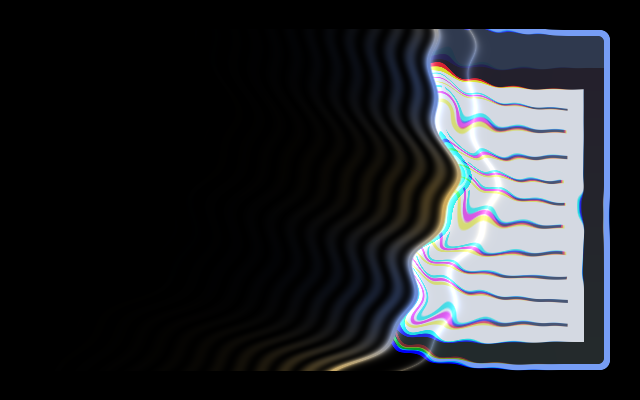

# Sky Manipulation

A bowed, rippling fold of space sweeps across the window as if the sky were being
grabbed like cloth. Closing swallows everything behind the front; opening unfolds
the window behind it. Both sweep the same way, so a close followed by an open
feels continuous. Near the front, content is dragged towards it and folds back
over itself, with a chromatic split, a glowing crease and strain lines on the
hidden side.



Closing frame at progress 0.45, captured with `tools/render-preview.py` in a
headless Umbriel session over synthetic sample content. It shows one intermediate
frame, not the complete animation.

## Use

Download [effect.toml](effect.toml) and [shader.glsl](shader.glsl) using GitHub’s
**Download raw file** button and save them together in
`~/.config/umbriel/shaders/community/animation/sky-manipulation/`. Keep the license
notice linked below with your files. See [installation](../../README.md#install)
for details.

Then merge this into `~/.config/umbriel/config.toml`:

```toml
[include]
files = ["shaders/community/animation/sky-manipulation/effect.toml"]

[animation]
enabled = true

[animation.windows_in]
enabled = true
effect = "sky-manipulation"
duration_ms = 550
curve = "easeout"

[animation.windows_out]
enabled = true
effect = "sky-manipulation"
duration_ms = 450
curve = "ease"
```

Append the include path to your existing `files` array and merge selectors into
existing tables. Including `effect.toml` defines the preset; the selector enables
it. [`config.toml`](config.toml) contains the same copyable example.

Animation selectors are global for the chosen event; per-application animation
assignment is not available in this API. Adjust `duration_ms` to change the timing.

## Theme palette

This preset enables `palette = true` in `effect.toml`. The rim, crease and strain
lines blend between `accent_primary` and `accent_secondary` from Umbriel's
`[colors]`. Set `palette = false` to use the shader's fallback blue and violet
(`FALLBACK_A`, `FALLBACK_B`). Window content keeps its own colours apart from the
chromatic split at the fold.

## Configuration options

Edit the existing `[effects.preset."sky-manipulation"]` table in [effect.toml](effect.toml).
The [complete configuration reference](../../README.md#configuration-reference) explains
selection, overrides, and accepted ranges.

| TOML setting | Shipped value | What changing it does |
| --- | --- | --- |
| `kind` | `"animation"` | Keep this kind: the source implements its `animation` entry point. |
| `shader` | `"shader.glsl"` | Loads the source beside this preset. |
| `palette` | `true` | Use theme accents for the light. Set false for the fallback colours. |

Edit the event tables in your main Umbriel configuration (the activation
example is [config.toml](config.toml)). Larger `duration_ms` gives a slower
transition. Both `[animation] enabled` and the event must be enabled.

| Event | Example duration | Example curve |
| --- | --- | --- |
| `[animation.windows_in]` | `550` ms | `"easeout"` |
| `[animation.windows_out]` | `450` ms | `"ease"` |

The front position follows clamped eased progress, so the curve shapes how the
sweep accelerates. Use `effect = ""` to clear the custom selection or event
`enabled = false` to disable the transition. Opening/closing `style` and `scale`
do not tune a working custom shader. There is no animation-preset TOML `speed`.

### Shader controls

Edit these constants at the top of [shader.glsl](shader.glsl), not in TOML.
Distances are logical pixels unless noted. Keep wavelengths, `FOLD_FALLOFF`,
`EDGE_SOFT`, `RIM_WIDTH` and `HALO_WIDTH` positive.

| GLSL control | Shipped value | Visual effect |
| --- | --- | --- |
| `SWIPE_ANGLE_DEG` | `12.0` | Sweep direction in degrees: 0 is left to right, 90 is top to bottom. |
| `ANGLE_JITTER_DEG` | `20.0` | Random ± spread per transition; 0 fixes the direction. |
| `FLIP_RANDOM` | `0.0` | `1.0` lets some transitions sweep the opposite way. |
| `CURVE` | `110.0` | How far the front bows in the middle. |
| `WOBBLE`, `WOBBLE_WAVELENGTH` | `16.0`, `150.0` | Ripple amplitude and spacing along the front. |
| `FOLD_DEPTH` | `110.0` | How far content is dragged towards the front. Above `FOLD_FALLOFF`, it folds back over itself. |
| `FOLD_FALLOFF` | `34.0` | How quickly the drag fades away from the front. |
| `RIPPLE_AMP`, `RIPPLE_WAVELENGTH` | `16.0`, `90.0` | Sideways cloth ripple near the front. |
| `LIQUID_AMP`, `LIQUID_WAVELENGTH` | `26.0`, `38.0` | Glassy bands trailing behind the fold. |
| `DISPERSION` | `0.30` | Chromatic split as a fraction of the drag; 0 disables it. |
| `EDGE_SOFT` | `3.0` | Softness of the cut edge. |
| `RIM_WIDTH`, `RIM_GAIN` | `3.5`, `1.2` | Width and brightness of the glowing edge. |
| `CREASE_GAIN` | `0.55` | Highlight where content folds over. |
| `HALO_WIDTH`, `HALO_GAIN` | `48.0`, `0.5` | Reach and brightness of strain lines on the hidden side. |
| `STRAIN_FREQ` | `0.30` | Strain-line density, in radians per logical pixel. |
| `FALLBACK_A`, `FALLBACK_B` | `vec3(0.42, 0.55, 1.00)`, `vec3(0.78, 0.45, 1.00)` | Light colours when `palette = false` (RGB 0–1). |

Larger `CURVE`, `WOBBLE` or `FOLD_FALLOFF` values lengthen the distance the front
travels, so the visible sweep becomes faster for the same duration.

Save and reload; see [reloading edits](../../README.md#reloading-edits).

## Compatibility and cost

Requires Umbriel with the preset effects API introduced in
[`512e2fb3`](https://github.com/noctalia-dev/umbriel/commit/512e2fb3). It does not
read `umbriel_time`, uses no previous-frame feedback buffers and contains no loops.
Each pixel takes three samples of the window. It runs only while the selected
transition is active. No performance benchmark is claimed.

## Validation and limitations

Tested with Umbriel `d3bff0fb2458`: configuration validation passed, and the
shader compiled and rendered in a headless session for opening (progress 0.5)
and closing (progress 0.45) captures. That build lacks test clock controls, so
capture timing is approximate. Interactive use on a live desktop, HDR, rotated
outputs and fractional scaling remain unverified.

The light can extend into transparent parts of the window rectangle. The drag
fades to exactly zero 5 × `FOLD_FALLOFF` from the front, and the front starts and
ends beyond that distance, so the visible endpoint matches the unmodified window
and the hidden endpoint is transparent for any tuning.

## Attribution

Author/contributor: AngieAlter. License: [MIT](../../LICENSES/AngieAlter-MIT.txt).
Unofficial work inspired by Takako Uro's Sky Manipulation in Jujutsu Kaisen.
