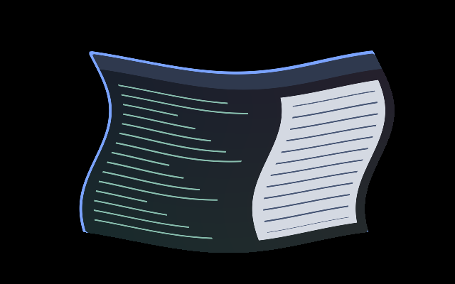

# Spooky Move

A slower, much stretchier variation of [Wobbly Move](../wobbly-move/), for
animated window moves, resizes and layout changes. The window bends like a
loose ghostly sheet, then returns to its original shape. Part of
[After Dark](../../families.toml).



The preview is a headless compositor capture over synthetic content at an
intermediate point. A still image does not demonstrate the complete motion.

[Watch the complete 1,400 ms move](preview.gif), captured with the shipped
`easeout` curve.

## Use

Save `effect.toml` and `shader.glsl` together under
`~/.config/umbriel/shaders/community/animation/spooky-move/`, retaining the
[MIT notice](../../LICENSES/Barrulus-MIT.txt). Merge [config.toml](config.toml)
into your configuration, appending to existing include lists and tables:

```toml
[include]
files = ["shaders/community/animation/spooky-move/effect.toml"]

[animation]
enabled = true

[animation.windows_move]
enabled = true
effect = "after-dark.spooky-move"
duration_ms = 1400
curve = "easeout"
```

Choose **After Dark → Apply family** in the plugin to use it with the other
family defaults. Including the preset alone registers it without enabling it.

## Tuning

The shipped duration is **1,400 ms**, versus Wobbly Move's 650 ms. Its
deformation strength is **3.0**, versus 1.0, and the sway has **1.5 cycles**
per transition, versus 2.5. This gives broader, slower bends and more settling
time. The inset grows with the deformation to keep it inside the captured
window rectangle; it cannot stretch the actual window geometry or hit area.

| Control | Default | Effect |
| --- | --- | --- |
| Event `duration_ms` | `1400` | Increase for slower movement and settling; try 1000–1800 ms. |
| Event `curve` | `"easeout"` | Controls native movement easing. The shader's sway follows linear progress. Spring curves choose their own duration. |
| GLSL `STRETCH_STRENGTH` | `3.0` | Deformation amplitude, clamped to 0–3. Zero samples the unmodified window; 1 gives the original amplitude with the slower sway. |
| GLSL `SWAY_CYCLES` | `1.5` | Oscillations per transition; try 1–2 for a slow sway. |

Edit shader controls in `shader.glsl`, and timing in your main configuration.
There is no animation-preset `speed` key. This effect preserves the window's
colours and alpha and does not use the palette. Clear the custom selector
with `effect = ""`, or disable movement animation with `enabled = false`.

## Compatibility and cost

Uses the same preset-effects API as Wobbly Move. Both endpoints return the
unmodified source, including clamped progress outside the event range.
One source sample per pixel, bounded trigonometric calculations, no loops and
no previous-frame feedback. The longer transition keeps rendering active longer.

The effect follows animated movement, resize and layout timelines. It does
not provide pointer-driven drag physics; `windows_drag` is a separate control.
Compiled and captured in headless Umbriel `0.1.0 (a37ae93)`, including landscape
and portrait windows. HDR, output rotation and fractional scaling have not
been visually verified.
No performance benchmark is claimed.

## Attribution

Adapted from Barrulus's [Wobbly Move](../wobbly-move/shader.glsl).
Author/contributor: Barrulus. License: [MIT](../../LICENSES/Barrulus-MIT.txt).
