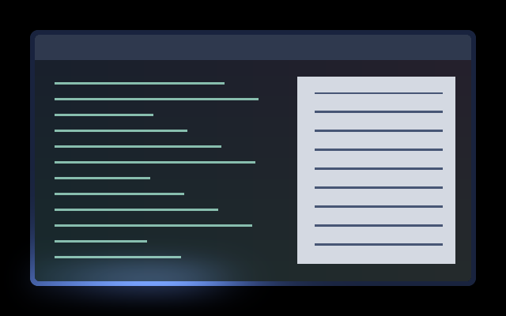

# Accent Runner

A soft, clockwise-moving accent travels around the focused window border. The moving highlight follows the active theme accent color, with a subtle breathing effect and a soft glow.

## Features

- A moving highlight that travels clockwise around the focused window.
- Theme accent color integration.
- Subtle breathing animation.
- Soft light spill that can illuminate darker areas inside the window.
- Adjustable animation speed, border padding, and light settings.

## Installation

Copy `effect.toml` and `shader.glsl` into your Umbriel community shader directory.

Merge the contents of `config.toml` into your Umbriel configuration. Do not duplicate existing `[include]` or `[effects]` tables.

The example configuration enables Accent Runner as the active border effect.

## Configuration

The default settings are defined in `effect.toml`:

| Setting | Default | Description |
| --- | ---: | --- |
| `padding` | `24` | Border effect padding |
| `speed` | `2.0` | Animation speed multiplier |
| `animated` | `true` | Enables animation |
| `light.spread` | `48` | Light spread |
| `light.intensity` | `2.0` | Light intensity |
| `light.threshold` | `0.4` | Light threshold |

The shader also contains a few visual parameters that can be adjusted:

| Shader parameter | Default | Description |
| --- | ---: | --- |
| Runner exponent | `10.0` | Controls the sharpness of the moving highlight |
| Base brightness | `0.25` | Minimum border brightness |
| Runner amplitude | `0.75` | Strength of the moving highlight |
| Palette blend | `0.30` | Influence of the theme accent color |
| Breathing amplitude | `0.10` | Subtle brightness variation |

## Compatibility and testing

Tested with:

- Umbriel `0.1.0` (`07181d995ee2`)
- CachyOS
- Hyprland
- NVIDIA GeForce GTX 1080 (8 GB)
- NVIDIA driver `580.196.07`
- Noctalia shell

This is a limited test configuration. Compatibility with other GPUs and drivers has not yet been verified.

## Performance

No formal performance benchmark has been conducted.

The shader samples the native border once per fragment and uses a small number of trigonometric and arithmetic operations to create the animation. Actual performance may vary depending on the GPU, compositor, and display configuration.

## Attribution and license

Adapted from Noctalia's bundled Umbriel pulse border preset.

Original source:
[Umbriel bundled pulse preset](https://github.com/noctalia-dev/umbriel/tree/c3d0eaafb1e31ee0abd99b547f85b5d52a28d0c7/examples/effects/border/pulse).

The original copyright notice and MIT license are preserved in
[LICENSES/Noctalia-MIT.txt](../../LICENSES/Noctalia-MIT.txt).

License: MIT.
