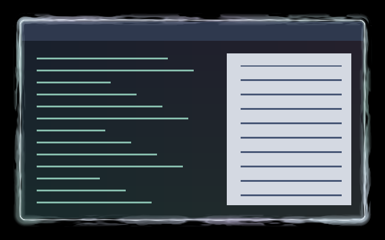

# Ghostly Tear Border

A luminous, uneven pearl thread follows the focused window. Mint and lavender
flame-like wisps form locally, curl to either side, rise outward and fade.
Independent patches brighten and soften over a gentle four-second breathing
cycle. Matching inner wisps curl up to eight logical pixels into the content,
fading softly to leave the centre untouched.



[Watch six seconds of the animated border](preview.gif).
Both previews are real compositor captures over synthetic light/dark content.
The GIF samples real-time animation at 15 fps; its loop restarts the preview.

## Use

Keep [effect.toml](effect.toml) and [shader.glsl](shader.glsl) together under
`~/.config/umbriel/shaders/community/border/ghostly-tear-border/`. Also install
the companion [effect.toml](../../window/ghostly-tear-overlay/effect.toml) and
[shader.glsl](../../window/ghostly-tear-overlay/shader.glsl) under
`~/.config/umbriel/shaders/community/window/ghostly-tear-overlay/`, retaining the
[license](../../LICENSES/Barrulus-MIT.txt). Merge [config.toml](config.toml)
into your configuration, appending to existing include lists and merging tables:

```toml
[include]
files = ["shaders/community/border/ghostly-tear-border/effect.toml"]

[effects]
border = "ghostly-tear-border"
```

Including the preset registers it; the selector activates it. Border effects
apply to the focused, decorated, non-urgent, non-fullscreen window. Window rules
and runtime border overrides can select a different effect.

Pairs with the [Ghostly Tear workspace transition](../../animation/ghostly-tear/).
It uses the same fixed pearl, mint and lavender blend independently of the theme
palette. The border definition includes and attaches `ghostly-tear-overlay`
automatically; do not include that companion a second time or select it as a
global window effect. It follows the border's focus gate and clock. No compositor
light pass is used.

## Tuning

In [effect.toml](effect.toml), `speed = 1.0` gives the intended movement.
Try `0.7` for slower curling or `1.3` for livelier wisps. `animated = false`
or `speed = 0.0` freezes the artwork. `padding = 16` reserves outward drawing
space; it is not the painted width. Keep it equal to `PADDING` in the shader.

Edit these constants in [shader.glsl](shader.glsl):

| Constant | Default | Effect |
| --- | --- | --- |
| `WISP_REACH` | `13.0` | Maximum outward reach in logical pixels beyond the thread; clamped to `2`–`14` with the default padding. Most wisps are shorter and fade before the limit. |
| `STRENGTH` | `0.95` | Overall opacity, clamped to `0`–`1`; try `0.75` for a fainter border. |
| `WISP_SPEED` | `1.0` | Speed multiplier for outward wisps and local curling; try `0.7`–`1.4`. The gentle overall pulse uses the preset's `speed`. |
| `PEARL`, `MINT`, `LAVENDER` | Pale RGB colours | Colour blend shared with the workspace transition. |

In the [companion shader](../../window/ghostly-tear-overlay/shader.glsl),
`INNER_REACH = 8.0` caps the inward reach in logical pixels (try `4.0`–`10.0`),
and `INNER_STRENGTH = 0.45` controls its tint (clamped to `0`–`0.6`). The overlay
preserves source alpha and returns the original content beyond its inner reach.
Keep both shaders' `WISP_SPEED` and colour constants matched when tuning them.

The border thread stays near the client edge even with wider native borders.
Outer wisps fade within the reserved padding; the companion handles the shallow
inner strip. Rounded arclength and periodic noise keep the
artwork continuous through corners and at the perimeter seam. Wisp roots stay
in place, tips sway in both directions, and motion flows outward. There is no
rotating colour band or circulating pulse.

## Compatibility and cost

Tested with **Umbriel 0.1.0 (`693b689`)**. Requires the preset border API with
`umbriel_border_hole`, `umbriel_border_radius` and `umbriel_border_distance`.
Four bounded procedural-noise evaluations per visible border fragment, with
an early return outside the artwork. The companion adds a window pass with one
source sample and four noise evaluations in its narrow edge strip; deeper
content returns immediately after the distance check. No feedback buffers,
texture assets or broad light/blur pass. Animation requests frames while the
border is visible; hardware performance is not benchmarked.

Native HDR, rotated-output and fractional-scale composition remain unverified.

## Attribution

Original shader by Barrulus. Rounded-perimeter helpers
adapted from this collection's Faerie Magic border, also by Barrulus.
[MIT license](../../LICENSES/Barrulus-MIT.txt).
