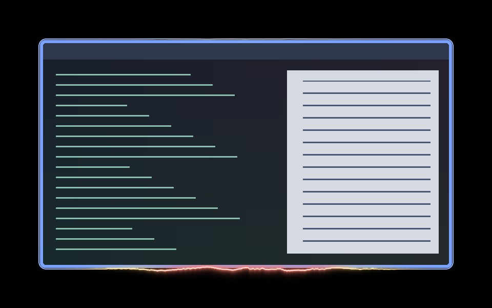

# Oscilloscope

A 64-band additive standing-wave border by **cows on Discord**. Audio drives a
bright trace along the bottom edge and a gentler trace along the top. The sides
and corners keep a steady glowing outline. Loud passages brighten the beam and
move its colour through the theme palette. Silence or a disconnected audio feed
leaves the steady outline; this is a spectrum-driven visualiser, not a PCM waveform.



Native Umbriel capture over synthetic window content with a synthetic spectrum
and the theme palette. This is not a recording of music playback.

## Use

Save [effect.toml](effect.toml) and [shader.glsl](shader.glsl) together in
`~/.config/umbriel/shaders/community/border/oscilloscope/`, retaining this
README's attribution and licensing notice. Merge these entries into your config:

```toml
[include]
files = ["shaders/community/border/oscilloscope/effect.toml"]

[effects]
border = "oscilloscope"
```

Append to an existing include list and merge existing tables instead of repeating
them. [config.toml](config.toml) contains the same example. The preset applies to
focused, decorated, non-fullscreen, non-urgent windows. No companion overlay is
needed. Including the preset alone does not select it or start audio capture.

Enable Noctalia's audio provider or run the
[standalone audio analyser](../../tools/README.md#standalone-audio-analyser).
Use only one provider. Requires Umbriel's 64-band spectrum input,
`umbriel_audio_entry()` and `umbriel_audio_available()`.

## Configuration options

| Control | Default | Effect |
| --- | --- | --- |
| GLSL `EDGE_MASK` | `(1.0, 0.1, 0.0, 0.0)` | Bottom, top, left, right response weights. Use values from 0 to 1. Zero disables motion on that edge, retaining its steady outline. |
| GLSL `BASELINE_PX` | `8.0` | Trace distance outside the client edge, in logical pixels. |
| GLSL `AMPLITUDE_PX` | `2.25` | Wave displacement multiplier. Larger values need more padding and can move the trace into the clipped client area. |
| TOML `padding` | `64` | External drawing space in logical pixels, allowing room for the trace and its glow. Smaller values reduce shaded area but can clip peaks or glow. |
| TOML `palette` | `true` | Use theme colours. False restores the original pale-blue fallback. |
| TOML `speed` | `1.0` | Standing-wave speed, from 0 to 10. Zero freezes the clock while audio can still change the shape. |
| TOML `animated` | `true` | Allow continuous wave motion. False freezes the clock at zero; audio updates still redraw. |

The native border remains beneath the trace. Border width is controlled by
`[appearance] border_width`, independently of the extra padding. Umbriel clips
all border effects out of the client rectangle, so inward-moving peaks can
briefly disappear. The bell envelope keeps motion away from corners.

## Compatibility and cost

Tested with Umbriel `a909081`: configuration validation, shader compilation and
native captures with active synthetic audio, silence and a disconnected feed.
One border pass, one native sample and up to 64 audio texture samples per visible
fragment on an active edge. No blur, compositor light or feedback buffers.

The port preserves the original 64 bands and wave equations. It skips fully
masked client pixels, skips synthesis on inactive edges or without an audio
provider, and skips roots and trigonometry for bands below the original noise
floor. Explicit constant-index calls let the compiler precompute each band's
fixed coefficients and texture coordinate. The original multiplicative frequency
recurrence, nested roots and inverse-square-root normalisation are retained.
The trace uses ascending `smoothstep` edges to avoid undefined GLSL behaviour.

Even silence from a connected provider requires 64 reads on active edges to
check the bands. Reading the clock requests frames while the border is active,
including during silence or disconnection. Set `[effects] max_fps` in your own
config to cap effect-driven redraws, or disable `animated` for audio-only updates.

An isolated GLES comparison against the original used Umbriel's shader wrapper,
synthetic spectra and RGBA8 output on an RTX 5060 Laptop GPU and Mesa llvmpipe.
It covered disconnection, silence, single-band, sparse and all-band input at
multiple clock values. At 960×600 with 64-pixel padding, the RTX 5060 comparison
measured the following median wall time per pass (five batches of 12 draws,
completed with `glFinish`; transparent native input and palette disabled):

| Synthetic input | Original | Optimised |
| --- | --- | --- |
| Connected silence | 0.085 ms | 0.030 ms |
| Eight active bands | 0.085 ms | 0.033 ms |
| All bands at maximum | 0.084 ms | 0.074 ms |

RGBA8 comparisons at times 0, 1, 17.5 and 1000 seconds differed by at most
2/255 in any channel. Constant folding and floating-point reassociation can
produce these small rounding differences. These checks do not establish compositor
frame time or performance on every GPU. Real music playback, HDR, output rotation
and fractional-scale compositor behaviour remain unverified.

## Attribution and licensing

Original shader: **cows on Discord**, GitHub account **acous**.
Source: [Umbriel border shader gist](https://gist.github.com/acous/0e3ae193232cdaffbdeb1ea34c652e50).
Community adaptation packages the preset and optimises synthesis while retaining
the original appearance and response.

The source gist does not declare a licence. This contribution does not assign
one on the author's behalf. Metadata records `LicenseRef-Unspecified` and
`publish = false`; catalogue publication awaits an explicit licence and review.
This shader is not covered by the repository's other contributors' MIT notices.
