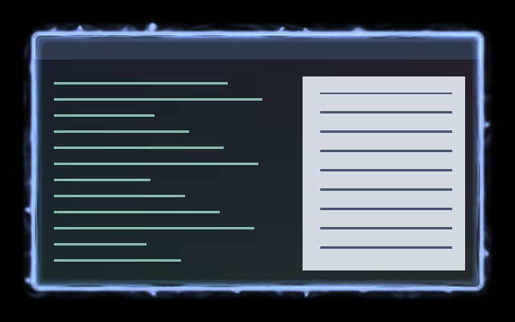

# Singularity Ring

A singularity's corona boils along the focused window's edge, its disc's rim and plasma just inside; swells with audio when a feed is present.



Preview rendered from this shader over a synthetic desktop sample with Umbriel's default palette; it is not a screenshot of a running session.

## Use

Download [effect.toml](effect.toml) and [shader.glsl](shader.glsl) using GitHub's **Download raw file** button and save them together in `~/.config/umbriel/shaders/community/border/singularity-ring/`. Keep the license notice linked below with your files. See [installation](../../README.md#install) for details.

Also download the companion [effect.toml](../../window/singularity-inner/effect.toml) and [shader.glsl](../../window/singularity-inner/shader.glsl) into `~/.config/umbriel/shaders/community/window/singularity-inner/`. This preset includes those files automatically.

Then merge this into `~/.config/umbriel/config.toml`:

```toml
[include]
files = ["shaders/community/border/singularity-ring/effect.toml"]

[effects]
border = "singularity-ring"
```

Append the include path to your existing `files` array and merge selectors into existing tables. Including `effect.toml` defines the preset; the selector enables it. [`config.toml`](config.toml) contains the same copyable example.

The [singularity-inner](../../window/singularity-inner/) overlay follows the focused border; it is not applied to every window. The [singularity cursor](../../cursor/singularity-cursor/) is the matching pointer effect.

## Theme palette

This preset enables `palette = true` in `effect.toml`. The corona takes its hue from the first palette colour (`accent_primary`) and keeps its own brightness and white-hot core. Set `palette = false` in this preset and in `singularity-inner` together to restore the original red.

## Audio

With an audio feed (see Umbriel's [audio input](https://github.com/noctalia-dev/umbriel/blob/main/docs/user/ipc.md#audio-input)), the corona reaches further and brightens with the music: bass along the top edge, treble along the bottom. Without a feed, or with a connected feed below about 0.02 level, it shows its idle look, identical in both cases.

## Configuration options

| TOML setting | Shipped value | What changing it does |
| --- | --- | --- |
| `palette` | `true` | Theme hue for the corona; false restores the original colours. Change both presets together. |
| `padding` | `22` | Logical pixels of extra outward drawing space. `REACH` in the shader must stay under border width + padding, or the plume tips are cut flat. |
| `speed` | `1.0` | Time multiplier for the ring and its overlay; 0 freezes them. |
| `animated` | `true` | Set false to freeze the ring and its overlay. |
| `overlay` | `"singularity-inner"` | Remove it (and the companion include) for the outer corona only. |

| Light setting | Shipped value | What changing it does |
| --- | --- | --- |
| `spread` | `10` | Logical-pixel reach of the compositor light. |
| `intensity` | `0.4` | Brightness of the light; 0 hides it. |
| `threshold` | `0.5` | Raise to emit only from the hottest corona pixels. |

### Shader controls

Edit these in [shader.glsl](shader.glsl). Keep the shared values in step with `singularity-inner`.

| GLSL constant | Shipped value | Visual effect |
| --- | --- | --- |
| `K_SCALE` | `0.42` | Logical px per ring px: the corona's overall size. |
| `REACH` | `24.0` | Logical px past the window edge where the corona has faded out; must fit in border width + `padding`. |
| `FADE` | `12.0` | Logical px over which the outer end tapers, so nothing is cut flat. |
| `BAND_THIN` | `0.30` | Width of the glow band against the window, as a share of its fitted width. |
| `OUT_THIN` | `0.5` | Plume length as a share of the fitted length. |
| `JITTER` | `0.35` | How far each slot's timing may drift off the shared 2 s loop, as a share of it. |
| `DRIFT` | `0.35` | Strength of the slow calm-to-hot swell along the outline. |
| `SURGE` | `0.67` | How much further the corona reaches on a full audio hit. |
| `CORNER_DIM` | `0.81` | Brightness kept round rounded corners to match the client's antialiased corner pixels; shared with the overlay. |

Save and reload; see [reloading edits](../../README.md#reloading-edits).

## Compatibility and cost

Requires Umbriel with the preset effects API introduced in [`512e2fb3`](https://github.com/noctalia-dev/umbriel/commit/512e2fb3), and the audio functions for the audio response. No previous-frame feedback buffers are used. Tested on Umbriel 0.1.0 (`13332d4`) with Mesa on a Radeon 680M.

This is a heavy border: every corona pixel evaluates up to 72 fitted sprites. Measured in a headless session on a Radeon 680M at 60 Hz with one 1188x788 window, the border added about 15 points of GPU time and the overlay about 2. It scales with the window's perimeter and the output's refresh rate. HDR, rotated outputs and fractional scaling are not tested.

## Attribution

Author/contributor: weegs710. License: [MIT](../../LICENSES/weegs710-MIT.txt).
