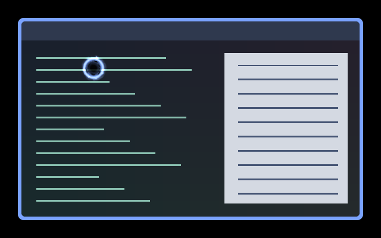

# Singularity Cursor

A miniature singularity orbits off the click point, chases the pointer with inertia when it moves and eases back into orbit; swells with audio when a feed is present.



Preview rendered from this shader over a synthetic desktop sample with Umbriel's default palette; it is not a screenshot of a running session.

## Use

Download [effect.toml](effect.toml) and [shader.glsl](shader.glsl) into `~/.config/umbriel/shaders/community/cursor/singularity-cursor/`, then merge this into `~/.config/umbriel/config.toml`:

```toml
[include]
files = ["shaders/community/cursor/singularity-cursor/effect.toml"]

[effects]
cursor = "singularity-cursor"
```

[`config.toml`](config.toml) contains the same example. It pairs with [singularity-ring](../../border/singularity-ring/).

At rest the ring orbits 38 px off the click point so it never covers it. When the pointer moves it chases its place on that orbit like a drone: critically damped, reacting 0.1 s late, trailing the pointer and easing in without overshoot. The motion is replayed from Umbriel's pointer path every frame, so it needs no feedback buffer. The cursor effect hides whenever the pointer is hidden, including Umbriel's `hide_when_typing`.

## Theme palette

`palette = true` takes the hue from the first palette colour; `palette = false` restores the original red.

## Configuration options

| TOML setting | Shipped value | What changing it does |
| --- | --- | --- |
| `radius` | `68` | Logical px drawn around the pointer and its path. Must cover `ORBIT_R + RING_R + REACH`, or the ring is clipped. |

### Shader controls

| GLSL constant | Shipped value | Visual effect |
| --- | --- | --- |
| `RING_R` | `15.0` | Ring radius in logical px. |
| `ORBIT_R` | `38.0` | Distance of the orbit from the click point in logical px. |
| `ORBIT_PERIOD` | `6.0` | Seconds per orbit. |
| `CHASE_W` | `7.75` | How tightly it follows; lower is lazier and trails further. |
| `CHASE_DELAY` | `0.1` | Seconds the chase reacts late. |
| `DISC_DARK` | `0.85` | How much the disc darkens what is under it, so its plasma reads on light backgrounds. |

Raising `RING_R` or `ORBIT_R` needs a matching `radius` in `effect.toml`.

## Compatibility and cost

Requires Umbriel's preset effects API ([`512e2fb3`](https://github.com/noctalia-dev/umbriel/commit/512e2fb3)) and the pointer path (`umbriel_pointer_path`). Tested on Umbriel 0.1.0 (`13332d4`) with Mesa on a Radeon 680M. Measured in a headless session at 60 Hz on a Radeon 680M: about 1.5 points of GPU time at rest and about 8 while the pointer sweeps fast circles. HDR, rotated outputs and fractional scaling are not tested.

## Attribution

Author/contributor: weegs710. License: [MIT](../../LICENSES/weegs710-MIT.txt).
