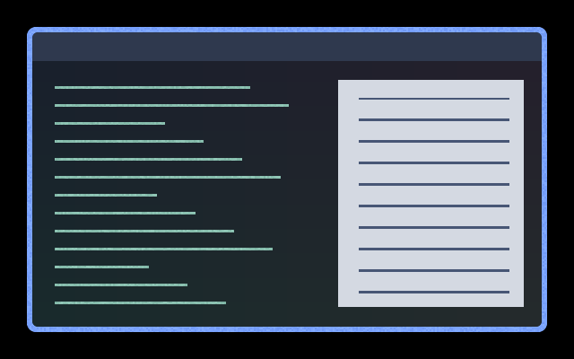
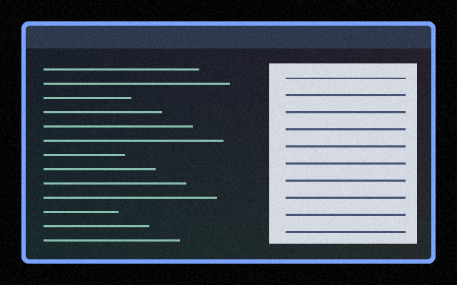

# Screen effects

[Installation and configuration](../README.md#install)

| Preview | Effect | Description |
| --- | --- | --- |
|  | [vignette](vignette/) | Darkened edges around the whole output. |
|  | [midnight-fog](midnight-fog/) | Low, translucent purple mist drifts along the bottom of the output. |

## Arcane-inspired family

- [Undercity Atmosphere](arcane-undercity-atmosphere/): Arcane Inspired family preset.

## Colour-blindness texture cues

Experimental animated texture cues; select one screen preset at a time.

| Preview | Effect | Description |
| --- | --- | --- |
|  | [CVD protan](cvd-protan/) | Coarse and fine animated grain selected by a protan colour-difference heuristic. |
|  | [CVD tritan](cvd-tritan/) | Coarse and fine animated grain selected by a tritan colour-difference heuristic. |
|  | [CVD deutan](cvd-deutan/) | Coarse and fine animated grain selected by a deutan colour-difference heuristic. |
|  | [CVD deutan-alphabet](cvd-deutan-alphabet/) | Four grain size and refresh-rate combinations encode deutan colour differences. |
|  | [CVD deutan-oriented](cvd-deutan-oriented/) | Angled animated streaks encode deutan colour differences. |
|  | [CVD deutan-combo](cvd-deutan-combo/) | Angled streaks vary in size with the deutan colour-difference magnitude. |
|  | [CVD deutan-drift](cvd-deutan-drift/) | Persistent grain drifts in a direction selected by deutan colour differences. |

## Film grain

| Preview | Effect | Description |
| --- | --- | --- |
|  | [Film Grain](film-grain/) | Subtle animated grain, with extra strength near black and white; originally intended as a visual-snow reading aid. |
