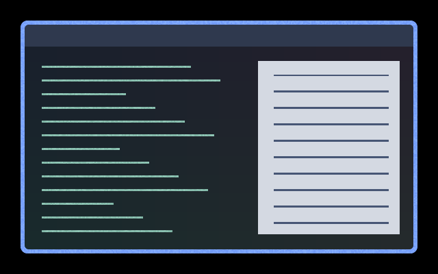

# CVD Deutan Drift

Persistent grain drifts in a direction selected by deutan colour differences. Applies across the whole output, including desktop and application content.
These experimental colour-blindness texture cues add equal offsets to RGB channels.
The inherited matrices are approximate heuristics, not calibrated vision simulations;
usefulness varies by viewer and content. This is not a colour correction filter.



Preview captured from the shader over synthetic desktop content. A still image does
not show the animation or establish accessibility effectiveness.

## Use

Save [effect.toml](effect.toml) and [shader.glsl](shader.glsl) together in
`~/.config/umbriel/shaders/community/screen/cvd-deutan-drift/`, retaining the
[MIT license notice](../../LICENSES/Barrulus-MIT.txt). Merge this configuration:

```toml
[include]
files = ["shaders/community/screen/cvd-deutan-drift/effect.toml"]

[effects]
screen = "cvd-deutan-drift"
```

Append the include to your existing `files` array and merge existing tables.
[config.toml](config.toml) contains the same example. Select one screen preset at a time.
See [installation](../../README.md#install) and [reloading edits](../../README.md#reloading-edits).

## Configuration

Edit the constants in [shader.glsl](shader.glsl): `STRENGTH` defaults to `0.22`;
reduce it for subtler texture or set it to `0.0` to disable the offset.
The `smoothstep(0.06, 0.45, loss)` thresholds control which colour differences receive
texture. Keep the lower threshold below the upper one. Grain cell dimensions and
refresh rates are specified directly in the shader; keep cell dimensions positive.
`SPEED = 30.0` controls drift in pixels per second.

The preset uses `kind = "screen"` and `shader = "shader.glsl"`; it does not use a palette.
There are no per-preset TOML speed or opacity controls. Global `[effects] max_fps`
limits effect-driven frames, and `in_capture` controls inclusion in captures.

## Compatibility and cost

Requires the named preset effects API introduced in
[`512e2fb3`](https://github.com/noctalia-dev/umbriel/commit/512e2fb3).
One source sample per fragment; no feedback buffers. Animation adds a full-output
pass and prevents direct scanout while active. No GPU benchmark, HDR, rotated-output
or fractional-scaling validation is claimed.

## Attribution

Original shader and screen adaptation by Barrulus, [MIT](../../LICENSES/Barrulus-MIT.txt).
Adapted from `docs/examples/shaders/window/cvd-deutan-drift.glsl` in the local `bumbriel`
shader library at commit `0eaaf298eec95351790d666bd7c0d7705b65d2d3`.
