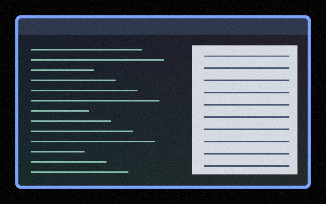

# Film Grain

Subtle animated grain across the whole output, refreshed at 15 Hz by default,
with extra strength near black and white. The same noise offset is added to
each RGB channel, preserving source alpha.

Retained from the older shader library, where it was intended as a visual-snow
reading aid. This describes its original intent; benefit for individual viewers
has not been validated.



Preview captured from the shader over synthetic desktop content. A still image
does not show its animation or establish reading comfort.

## Use

Save [effect.toml](effect.toml) and [shader.glsl](shader.glsl) together in
`~/.config/umbriel/shaders/community/screen/film-grain/`. Retain both license
notices linked below. Merge this configuration:

```toml
[include]
files = ["shaders/community/screen/film-grain/effect.toml"]

[effects]
screen = "film-grain"
```

Append the include to your existing `files` array and merge existing tables.
[config.toml](config.toml) contains the same example. Select one screen preset
at a time; this replaces any selected CVD texture preset.
See [installation](../../README.md#install) and [reloading edits](../../README.md#reloading-edits).

## Configuration

Edit these constants in [shader.glsl](shader.glsl):

| GLSL control | Default | Effect |
| --- | --- | --- |
| `GRAIN_INTERVAL` | `15.0` | Noise refreshes per second; keep positive. |
| `GRAIN_OPACITY` | `0.035` | Grain amplitude; reduce for subtler grain, or set to zero to disable. |
| `GRAIN_SIZE` | `1.0` | Grain cell size in output pixels; keep positive. Try 2 or 3 for coarser grain. |
| Gain thresholds | `0.85, 0.95` | Where the boost engages near black and white; keep ascending within 0–1. |
| Gain boost | `1.10` | Adds up to 1.10 to the base gain of 1.0. |

The preset uses `kind = "screen"` and `shader = "shader.glsl"`; it does not use
a palette. There are no per-preset TOML speed or opacity controls. Global
`[effects] max_fps` limits effect-driven frames, and `in_capture` controls
inclusion in captures.

## Compatibility and cost

Requires the named preset effects API introduced in
[`512e2fb3`](https://github.com/noctalia-dev/umbriel/commit/512e2fb3).
One source sample per fragment; no feedback buffers. Animation adds a full-output
pass and prevents direct scanout while active. No GPU benchmark, HDR,
rotated-output or fractional-scaling validation is claimed.

## Attribution

Based on [BanchouBoo's picom grain shader](https://github.com/BanchouBoo/dots/blob/88426abea8d70426a70449863b3573a9ff2ead5a/.config/picom/main.glsl),
released under the [Unlicense](../../LICENSES/BanchouBoo-Unlicense.txt).
Umbriel adaptation by Barrulus, [MIT](../../LICENSES/Barrulus-MIT.txt).

Ported from `docs/examples/shaders/window/film-grain.glsl` in the local `bumbriel`
library at commit `0eaaf298eec95351790d666bd7c0d7705b65d2d3`, retaining its
pixel-quantized noise and near-black/near-white gain.
