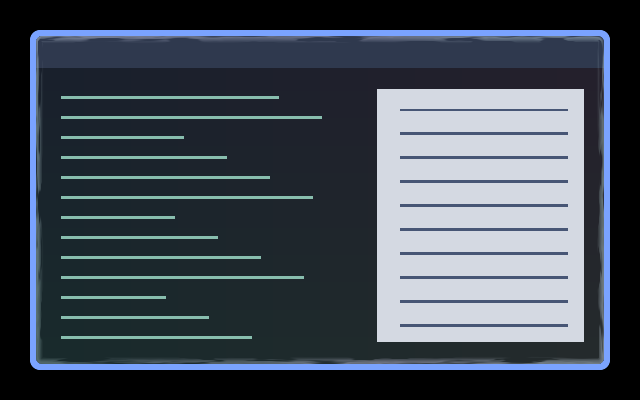

# Ghostly Tear Overlay

Shallow pearl, mint and lavender wisps curl into the window from its edges.
The effect fades completely by **8 logical pixels** inside the rounded client
edge. Local wisps form, bend to either side and fade; there is no circling motion.

This is a real private headless compositor capture over synthetic light/dark
content, showing the inward layer alone. The
[paired border preview](../../border/ghostly-tear-border/preview.gif) shows both layers.

## Use

This is the companion to [Ghostly Tear Border](../../border/ghostly-tear-border/).
Install [effect.toml](effect.toml) and [shader.glsl](shader.glsl) together under
`~/.config/umbriel/shaders/community/window/ghostly-tear-overlay/`, keeping the
[license](../../LICENSES/Barrulus-MIT.txt).

The border preset includes and selects this overlay automatically. Do not also
include it separately. As a border companion it follows the border's focus,
decoration and fullscreen gating, speed and animation clock. It adds inner
wisps without replacing your ordinary window-effect selection.

[config.toml](config.toml) is an optional standalone example; selecting it as
`[effects] window` instead applies it to windows without the border's focus gate.

## Tuning

In [shader.glsl](shader.glsl):

| Constant | Default | Effect |
| --- | --- | --- |
| `INNER_REACH` | `8.0` | Maximum depth in logical pixels, clamped to `1`–`12` and at most one fifth of the window's shorter dimension. Try `4`–`10`. |
| `INNER_STRENGTH` | `0.45` | Tint strength, clamped to `0`–`0.6`; zero preserves all content. |
| `WISP_SPEED` | `1.0` | Speed of local curls and inward wisps; keep matched with the border. |
| `PEARL`, `MINT`, `LAVENDER` | Pale RGB colours | Fixed colour blend; keep matched with the border. |

## Compatibility and cost

Tested with **Umbriel 0.1.0 (`693b689`)**, including its injected
`umbriel_corner_radius` uniform for matching the actual client corners.
Source alpha is preserved. Beyond the configured inner reach, the shader
returns the original sample exactly, without noise evaluation.

One source texture sample per fragment and four procedural-noise evaluations
within the narrow inner strip. A companion adds a window pass; no feedback
buffers or texture assets are used. Native HDR, output rotation, fractional
scaling and hardware performance remain unverified.

## Attribution

Original shader by Barrulus, derived from the matching
Ghostly Tear Border. Rounded-perimeter helpers originate in Barrulus's Faerie
Magic border. [MIT license](../../LICENSES/Barrulus-MIT.txt).
