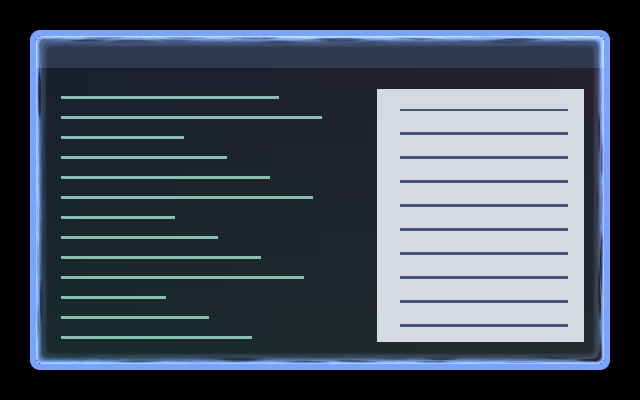

# Singularity Inner

The inner-window half of the singularity-ring border: the disc's rim gradient and boiling plasma along the window edge.

Preview rendered from this shader over a synthetic desktop sample with Umbriel's default palette; it is not a screenshot of a running session.

## Use

This is the companion overlay of [singularity-ring](../../border/singularity-ring/); install it with that border, which includes and attaches it automatically. Save [effect.toml](effect.toml) and [shader.glsl](shader.glsl) in `~/.config/umbriel/shaders/community/window/singularity-inner/`.

[`config.toml`](config.toml) selects it as a window effect on its own for testing; normally leave the window slot to your other choice and let the border draw it on the focused window.

The plasma is added as light over the window, so the content underneath stays readable.

## Theme palette

`palette = true` takes the hue from the first palette colour, like the ring. Change `palette` in both presets together.

## Shader controls

Edit these in [shader.glsl](shader.glsl); `CORNER_DIM`, `CORNER_R0` and `CORNER_R1` are shared with the ring.

| GLSL constant | Shipped value | Visual effect |
| --- | --- | --- |
| `K_SCALE` | `0.12` | Logical px per ring px across the band: its depth into the window. |
| `TH_SCALE` | `0.45` | Logical px per ring px along the edge: the plasma's pattern size. |
| `DEPTH` | `100.0` | Ring px in from the edge where the plasma has faded into the core. |
| `BOIL` | `0.65` | Seconds per unit of boil; larger boils slower. |
| `WALL` / `HAZE` | `2.4` / `2.4` | Weight of the cell walls and the slow haze in the plasma. |
| `DET` | `1.7` | Weight of the fast fine grain. |

## Compatibility and cost

Same requirements as [singularity-ring](../../border/singularity-ring/#compatibility-and-cost). The plasma runs worley and value noise per pixel in a band about 12 logical px deep; near the corners it runs twice to blend the two edges. Measured about 2 points of GPU time on a Radeon 680M at 60 Hz with a 1188x788 window.

## Attribution

Author/contributor: weegs710. License: [MIT](../../LICENSES/weegs710-MIT.txt).
